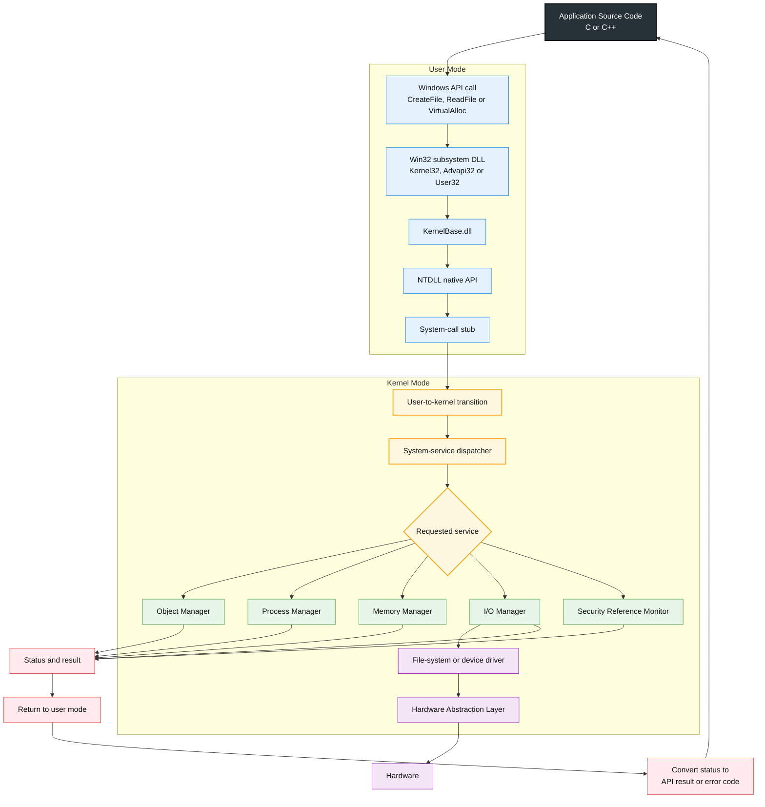

    

        
    

# **`Awesome`** Windows System Programming Resources

 

    
    &nbsp;
    
    &nbsp;
    
    

## 📖 Contents
- [Books](#books)
- [Videos](#videos)
- [My Other Awesome Lists](#my-other-awesome-lists)
- [Contributing](#contributing)
- [Contributors](#contributors)

##

### Books

### Videos

### Video Series
- [Windows System Programming in C/C++ by @ASystemProgrammingChannel](https://youtube.com/playlist?list=PLDpFwQfbVxIw_rysNCHPeGmh6wIUnhjrt&si=iJ3z__JQXribLRPF)
- [Windows System Programming by @pentesteracademy](https://youtube.com/playlist?list=PLRJWiLCmxyxiSujVWVL-SpLelqU7L3urx&si=AR25IlMyD1cPqKBO)

##

### My Other Awesome Lists
You can access the my other awesome lists [here](https://cyberthreatdefence.com/my_awesome_lists)

### Contributing
[Contributions of any kind welcome, just follow the guidelines](contributing.md)!

### Contributors
[Thanks goes to these contributors](https://github.com/cybersecurity-dev/awesome-windows-system-programming-resources/graphs/contributors)!

### License

[🔼 Back to top](#awesome-windows-system-programming-resources)
